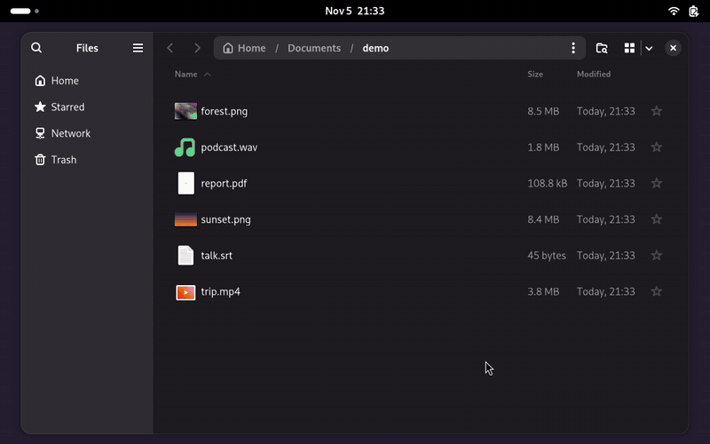

# ShiftDrop



Drag a file, hold Shift, drop it on a format: a local file converter for GNOME and Windows.

```
curl -fsSL https://raw.githubusercontent.com/jayhemnani9910/shiftdrop-rust/main/install.sh | sh
```

[](https://github.com/jayhemnani9910/shiftdrop-rust/actions/workflows/ci.yml)
[](LICENSE)

That line needs GNOME 49+ on Wayland and x86_64. It doesn't install the converters, so add those too:

```
sudo apt install ffmpeg imagemagick ghostscript poppler-utils libreoffice-writer
```

GNOME only notices a new extension at login, so log out and back in once. [Other ways to install](#install), and [Windows](#windows).

## Use

```
Shift while dragging          format wheel: video, image, audio, PDF, text, subtitles
Shift + Ctrl while dragging   tools wheel:  compress, metadata, resize, rotate, trim, normalize, PDF, merge
Files right-click             Scripts > ShiftDrop: the same wheel, pick by clicking (right-click switches)
drop on the centre / Esc      cancel
```

Outputs go next to the original and never overwrite anything (`photo.jpg`, `photo 2.jpg`, `clip compressed.mp4`).
If that folder is read-only, they go to `~/ShiftDrop` instead.
Drops are only ever taken as a copy, so the file you dragged stays where it was.
Cancel in the status pop-up stops a job and removes what it wrote. A job killed some other way
(`pkill`, logout) has its half-written file removed the next time the app starts.

There's a command line too:

```
shiftdrop targets clip.mp4
shiftdrop convert --to webm clip.mp4
shiftdrop tool trim clip.mp4 --start 2 --end 9
```

The launch film (36 s):

https://github.com/user-attachments/assets/8bd05d02-ee88-4634-89d8-47a888a88cfb

## How it works

Wayland apps can't see other apps' drags or place their own windows, but the shell can. So a small GNOME Shell
extension watches for a drag and the Shift key, then asks the app over D-Bus to show the wheel and puts it under
the pointer. The wheel is an ordinary drop target, so the app gets the file list the normal way. It then runs
ffmpeg, ImageMagick, Ghostscript, Poppler or LibreOffice on your computer. Nothing is sent anywhere.

```
extension/   GNOME Shell extension. Sees drags start and end and the Shift key (Wayland apps can't),
             asks the app to show the wheel over D-Bus, puts the wheel under the pointer
src/
  main.rs      the app; on Linux also the command line
  app.rs       Linux: GTK4 wheel window (a plain drop target) + status pop-up + trim/resize dialogs
  wheel.rs     Linux: cairo drawing for the wheel
  win/         Windows: mouse hook (does the extension's job), wheel as OLE drop target,
               Direct2D drawing, status pop-up, dialogs, Send To
  session.rs   what the wheel offers, running a batch, the result summary (both systems)
  ring.rs      wheel geometry and hit-testing (both systems)
  cli.rs       the command line (shiftdrop-cli.exe on Windows)
  formats.rs   what a file is and what it can become (rules per category)
  media.rs     what's inside a media file (ffprobe), whether GPU H.264 works
  convert.rs   conversion -> list of commands (ffmpeg, magick, pdftoppm, soffice, heif-enc)
  tools.rs     tool -> list of commands
  jobs.rs      runs the commands, ffmpeg progress, removes half-written files on failure
  sys.rs       what differs between Linux and Windows: starting programs, PATH, folders
packaging/     .deb files (Linux), installer and manifest (Windows)
```

## Install

Needs GNOME 49+ on Wayland (x86_64 for the ready-made builds). Pick one:

```
# for your user, no Rust needed: downloads the latest release
curl -fsSL https://raw.githubusercontent.com/jayhemnani9910/shiftdrop-rust/main/install.sh | sh
sudo apt install ffmpeg imagemagick ghostscript poppler-utils libreoffice-writer

# for every user on the machine, converters included
wget https://github.com/jayhemnani9910/shiftdrop-rust/releases/latest/download/shiftdrop_amd64.deb
sudo apt install ./shiftdrop_amd64.deb

# from source
sudo apt install libgtk-4-dev ffmpeg imagemagick ghostscript poppler-utils libreoffice-writer
./install.sh
```

The `.deb` leaves out the Files right-click script (Files only reads those per user); the other two add it.

If you don't want to log out, load the extension into the running shell: Alt+F2, `lg`, Evaluator tab, paste:

```js
(async () => { const em = Main.extensionManager, uuid = 'shiftdrop@jayhemnani'; const ext = em.createExtensionObject(uuid, imports.gi.Gio.File.new_for_path(imports.gi.GLib.get_home_dir() + '/.local/share/gnome-shell/extensions/' + uuid), 2); await em.loadExtension(ext); })()
```

`gnome-extensions info shiftdrop@jayhemnani` should then say `State: ACTIVE`, else run `gnome-extensions enable shiftdrop@jayhemnani`.

To remove: `./uninstall.sh`, or `curl -fsSL https://raw.githubusercontent.com/jayhemnani9910/shiftdrop-rust/main/uninstall.sh | sh`,
or `sudo apt remove shiftdrop` for the `.deb`.

## Windows

Windows 10 or 11, x64. Download `ShiftDrop-Setup-x64.exe` from the
[latest release](https://github.com/jayhemnani9910/shiftdrop-rust/releases/latest) and run it. It starts
ShiftDrop at sign-in, adds it to Explorer's **Send To** menu, and can install FFmpeg, ImageMagick, Poppler
and LibreOffice with winget. Ghostscript (for compressing PDFs) comes inside the installer.

The installer isn't signed yet, so SmartScreen says "Windows protected your PC": click **More info**,
then **Run anyway**.

Drag a file, hold **Shift** (and **Ctrl** for tools), drop it on a format, as on Linux. A drag that starts
in a program running as administrator can't reach the wheel; Windows keeps those apart. ShiftDrop writes
what each drag did to `%LOCALAPPDATA%\shiftdrop\shiftdrop.log`. On Windows the command line is
`shiftdrop-cli.exe`.

## Speed

Video and audio run one at a time. Images and documents run 4 at a time.

```
container change, codec already fits   copy, no re-encode
re-encode to MP4/MOV/MKV               GPU H.264 at qp 26, or CPU x264 (fast, crf 21) when the GPU can't
re-encode to WebM                      AV1 (SVT, preset 8, crf 35)
compress video                         CPU x264 (faster, crf 28)
```

One run on my laptop (i7-11370H, 8 threads, Intel GPU), with a generated, deliberately noisy 20 s clip at
1080x1920 and 60 fps, 426 MB:

```
to MKV, copy         0.8s
to M4A, copy         0.3s
to MOV, copy         0.5s
to WebM             37.2s   24.3 MB
compress            21.2s    9.6 MB
```

16 generated 1920x1080 PNGs: WebP 7.6s, AVIF 6.5s, JPG 0.8s.

HDR (PQ/HLG) is kept when copying or writing AV1, and tone-mapped to SDR for H.264, Xvid and WMV.
Rotated phone videos stay upright. Removing metadata keeps the colour profile; with `jpegtran` installed
(`libjpeg-turbo-progs`) JPEGs are cleaned losslessly.

## Debugging the drag

`touch ~/.cache/shiftdrop-debug`, then watch `journalctl --user -f -o cat | grep shiftdrop`. Each drag logs
`drag-begin` -> `shift at` -> `show-wheel ok` -> `wheel placed` -> `drag carries` -> `drop at` -> the job result.
The first missing line is where it broke. `rm ~/.cache/shiftdrop-debug` to stop.

## After a GNOME upgrade

The extension lists the GNOME Shell versions it was tried on (`shell-version` in `metadata.json`), and it
finds the wheel by its window title, which a Shell change can quietly break. After each upgrade:

```
gnome-extensions info shiftdrop@jayhemnani    # State: ACTIVE. OUT OF DATE means add the new version to metadata.json
```

Then do one Shift-drag with the debug flag on (above). `show-wheel ok` without `wheel placed` means the
Shell no longer hands over the window the way `_onWindowCreated` expects.

## Not yet

Crop, redact, annotate and other tools that need a canvas. Archives.

## Contributing

See [CONTRIBUTING.md](CONTRIBUTING.md).

## Licenses

ShiftDrop is MIT licensed (`LICENSE`). The Windows installer also ships Ghostscript, which is AGPL; its
source is at <https://github.com/ArtifexSoftware/ghostpdl>.

## Code signing policy

Windows builds are to be signed through [SignPath Foundation](https://signpath.org) (free code signing for
open source, certificate by SignPath Foundation), once accepted. Only binaries built by this repository's
GitHub Actions from its own source are signed.

- Committers and reviewers: Jay Hemnani ([@jayhemnani9910](https://github.com/jayhemnani9910))
- Approvers: Jay Hemnani

Privacy: ShiftDrop converts files on your computer and sends nothing anywhere. The Windows installer
downloads converters with winget only for the boxes you tick.
